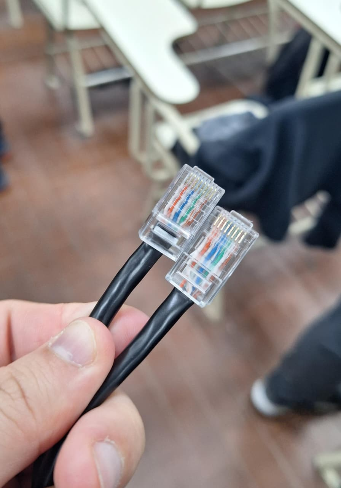
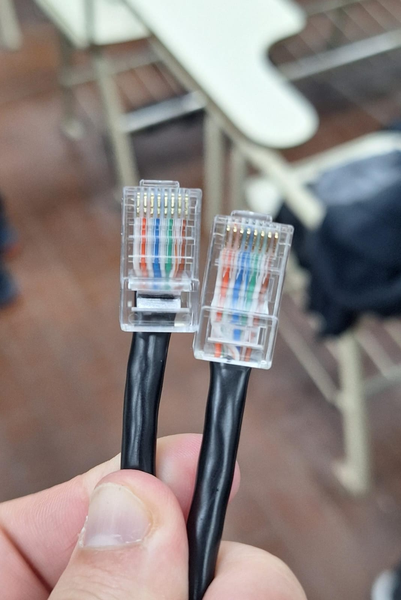
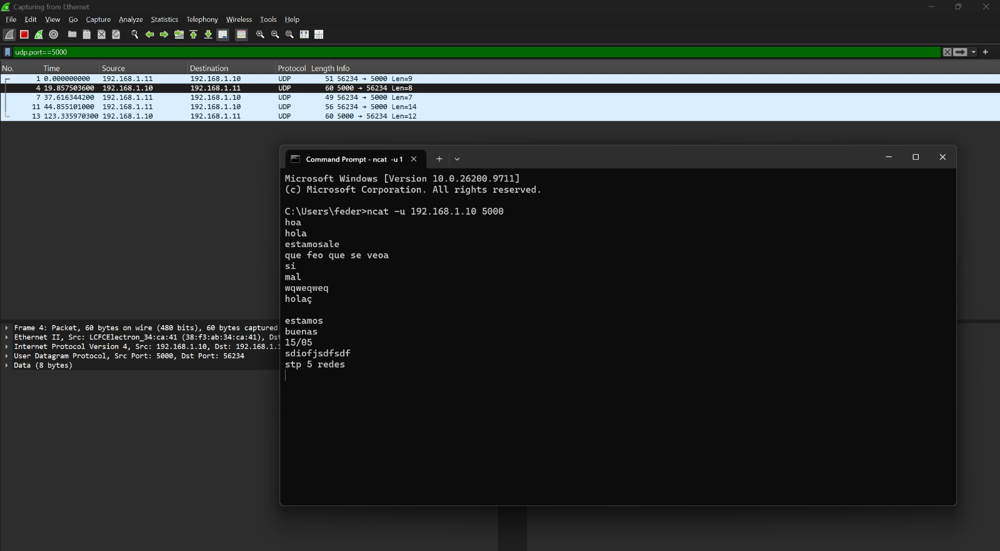
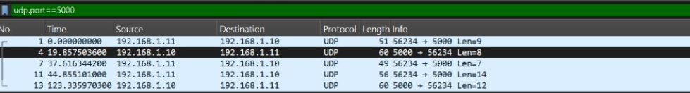

# Trabajo práctico N°  6 - Redes de Computadoras

**Grupo:** LAN-gustia

---

## Integrantes
* Alvarado, Jazmin
* Aroca Bustos, Nahuel Ezequiel
* Ibarra, Franco Ismael
* Lucero, Fabricio Agustin
* Soto, Milton Joaquin
* Zulaica, Federico Jose

---

## Desarrollo

# Parte 1: Taller de armado y verificación de cables Cat5/Cat5e bajo estándar T568A/B.

Para realizar el armado del cable de red, investigamos el procedimiento de crimpado de cables Ethernet cat5 segun el estandar T568B. Este estandar establece el orden de los ocho conductores dentro del conector RJ45. Para construir un cable derecho, se debe utilizar el mismo estandar en ambos extremos.

El procedimiento de armado fue el siguiente:
1. Cortamos el cable de red de aproximadamente 1,5 metros.
2. Retiramos unos 2 cm de la aislacion externa del cable.
3. Destrenzamos y acomodamos los ochos conductores siguiendo el orden de colores correspondientes al estandar T568B.
4.  Emparejamos los extremos de los conductores para que tengan la misma longitud.
5. Insertamos los conductores dentro del conectar, vetificando que cada uno llegue hasta el fondo y se mantenja el orden establecido.
6. Usamos una pinza crimpeadora para fijar el conector al cable y asegurar el contacto electrico de los conductores.
7. Repetimos el procedimiento para el otro extremo del cable.

# Parte 2: Equipamiento físico, verificación y utilización de equipos de red y generación de tráfico.

## Levantar y testear una LAN
## 1) 

Para realizar la actividad, se configuró manualmente la interfaz de red de una computadora, asignándole una dirección IPv4, una máscara de subred y una puerta de enlace predeterminada.

Los valores de ejemplo utilizados para documentar la configuración son:

| Parámetro | Valor |
|---|---|
| Dirección IPv4 | `192.168.1.10` |
| Máscara de subred | `255.255.255.0` |
| Puerta de enlace predeterminada | Sin configurar |

### d) Justificación de las direcciones elegidas

La dirección IPv4 identifica la interfaz de red de la computadora dentro de la LAN. Se eligió una dirección privada perteneciente al rango `192.168.1.0/24`, utilizado habitualmente en redes locales.

La máscara `255.255.255.0` equivale a `/24`. Esto permite que las computadoras con direcciones pertenecientes a la misma subred se comuniquen directamente a través del switch, sin necesidad de que un router intervenga en la comunicación local.

Para que la comunicación funcione, cada computadora debe tener una dirección IP única dentro de la subred y una máscara compatible con la del resto de los equipos.

La puerta de enlace predeterminada se utiliza para enviar paquetes hacia redes diferentes de la red local. Al realizar la actividad únicamente entre computadoras conectadas al mismo switch, sin un router, no es necesaria para comunicarse entre ellas. Por lo tanto, no corresponde asignar una dirección de gateway ficticia.

## 2) 

Una vez configuradas las interfaces de red, se conectó una computadora por grupo al switch TP-LINK TL-SF1005D mediante los cables armados

### Verificación de conectividad mediante ping

Se utilizó  `ping` para comprobar la comunicación entre computadoras de distintos grupos, enviando solicitudes ICMP Echo Request a la dirección IPv4 de la otra computadora.
Nuestra computadora tenia la ip `192.168.1.10` y la otra la `192.168.1.11`

|Ping a `192.168.1.10` | 
| |

|Ping a `192.168.1.11` | 
| |

Al recibir respuestas, se confirma que existe conectividad IP entre las dos computadoras en ese momento.

##  LAN: tráfico UDP

1) **Receptor y Emisor UDP con ncat** 
Una vez verificada la conectividad física (mediante ping), procedimos a establecer la comunicación mediante el protocolo UDP utilizando la herramienta ncat (utilizando los comandos especificados en la consola de comandos).   

* En la computadora receptora (192.168.1.11), levantamos el servicio de escucha en el puerto asignado ejecutando en la terminal: *ncat -u -l 5000*.   
* En la computadora emisora (192.168.1.10), iniciamos la transmisión mediante el comando: *ncat -u 192.168.1.11 5000*. Al redactar y presionar Enter, los mensajes fueron inyectados al medio físico. 

2) **Captura de Tráfico con Wireshark**
Durante la transmisión de los mensajes, ejecutamos Wireshark en la interfaz Ethernet de la computadora receptora, aplicando el filtro de visualización udp.port == 5000. La captura evidenció el flujo de datagramas originados desde la IP .10 dirigidos hacia la IP .11. Al inspeccionar la sección de datos (payload) de los paquetes seleccionados, constatamos que la carga útil contenía en texto plano los mensajes exactos redactados en la terminal del emisor.

---

**Respuestas punto 5**

* **a. ¿Se observa algún procedimiento de establecimiento de conexión antes de enviar los datos?**

No. A diferencia de TCP, en nuestra captura no se observa ningún handshake previo. La PC emisora (.10) inyecta el datagrama UDP directamente a la red hacia el destino (.11) con el mensaje ya incluido desde el primer paquete.

* **b. ¿Existe algún mecanismo de confirmación de recepción equivalente a los ACK de TCP?**

No. En Wireshark se evidencia que la PC receptora (.11) procesa los datos pero no devuelve ningún paquete de confirmación (ACK) hacia la red. Al ser no fiable, UDP simplemente entrega el mensaje sin avisar si llegó con éxito.

* **c. ¿Qué ocurre si se envían mensajes mientras el receptor UDP no está ejecutándose?**

El emisor inyecta el datagrama de todas formas, pero al llegar a la PC receptora, el sistema operativo lo descarta porque el puerto 5000 está cerrado. Como respuesta, la PC receptora genera y devuelve automáticamente un paquete de error ICMP ("Destination Unreachable - Port Unreachable") para avisar que nadie está escuchando.

* **d. ¿UDP garantiza que los mensajes lleguen en el mismo orden en que fueron enviados?** 

No, UDP no tiene niguna garantia de que los mensajes lleguen en el mismo orden en el que fueron enviados, ya que no tiene numeros de secuencia, cada datagrama viaja por su cuenta, puede llegar duplicado, desordenado o no llegar.

* **e. ¿Qué aplicaciones reales utilizan UDP y por qué?** 

Hay diversas aplicaiones de redes que utilzan UDP:
    
VoIP, videollamadas y streaming en vivo: importa más la latencia que perder algún paquete, porque un paquete retransmitido llega tarde y ya no sirve.

Juegos online: siempre vale más el estado más reciente que uno viejo retransmitido.

DNS: son consultas cortas de ida y vuelta, y un handshake de TCP costaría más que la consulta misma.

DHCP: el cliente todavía no tiene IP, así que usa broadcast, algo que TCP no permite.

## Desarrollar un pequeño servidor

