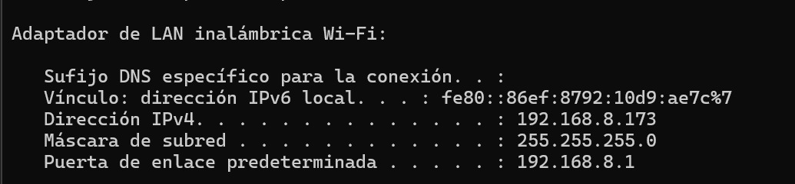

# Trabajo práctico N°  7 - Redes de Computadoras

**Grupo:** LAN-gustia

---

## Integrantes
* Alvarado, Jazmin
* Aroca Bustos, Nahuel Ezequiel
* Ibarra, Franco Ismael
* Lucero, Fabricio Agustin
* Soto, Milton Joaquin
* Zulaica, Federico Jose

---

## Desarrollo

## Parte 1: desafío 

* **IP, Máscara y Broadcast MAC**
A través del comando ipconfig, se obtuvo la dirección IPv4 **192.168.8.173** con máscara de subred **255.255.255.0**.



* **Procedimiento de Captura y Observaciones en Wireshark**

    * Configuración y Filtrado: Iniciamos la captura en Wireshark seleccionando el Wi-Fi correspondiente. Dado que la consigna indicaba que el mensaje se enviaba por difusión (broadcast) cada 30 segundos, aplicamos inmediatamente el filtro de visualización **eth.dst == ff:ff:ff:ff:ff:ff**. Esto nos permitió limpiar el ruido de la red del aula y aislar únicamente las tramas de Capa 2 dirigidas a todos los hosts.

    * Intercepción del Datagrama: Tras unos segundos de monitoreo, la lista de paquetes de Wireshark registró el ingreso de un datagrama dirigido a la dirección IP de broadcast de nuestra subred.

    * Inspección de la Carga Útil (Payload): Al hacer clic sobre el paquete interceptado, nos dirigimos al panel inferior de Wireshark (volcado hexadecimal y ASCII).

    * Extracción de Datos: Haciendo clic derecho sobre la sección de datos del paquete (Data), seleccionamos la opción Copy -> ...as Printable Text (o ASCII). Esto nos permitió llevar el contenido al portapapeles para su análisis.

* **Análisis Estructural del Mensaje**

El texto extraído de la carga útil de Wireshark reveló una estructura de datos estándar en formato JSON. El formato observado consta de los siguientes tres campos clave:

**"SIZE"**: Declara las dimensiones exactas de la matriz bidimensional original (indicando cantidad de Filas y Columnas).

**"PL" (Payload)**: Contiene una cadena continua de unos y ceros correspondientes al bloque de datos transmitido.

**"CHECK"**: Representa los bits de control calculados por el emisor (primero las paridades de las filas, luego las de las columnas).

* **Análisis y corrección del mensaje**

El mensaje recibido fue: 

{"SIZE": "8,7", "PL": "11010001110100111010011100001110011011101001011110101111111100111011111110101111010011101011100010110010101011101100011110111111011010101111111001111010001101111111001011101001110011010111111100010111000111011111001111001011111101010010101110111101000011000010100100011111111001101100101110000111101001110101111001010001010111101111001111010001100001111001011001010100000010000001000000100000", "CHECK": "011111010110111111110110011100101111001100001100110010001"}

detectamos fallas en 3 filas y 3 columnas, generando 6 permutaciones posibles. El texto extraído antes de aplicar las correcciones era: 
[https://youtube.com/shorts/q8wgKzJwPa$?featurE=share](https://youtube.com/shorts/q8wgKzJwPa$?featurE=share) 

el cual evidenciaba corrupción en tres caracteres (w, $, E).

* **Verificación de Integridad y Cálculo**
utilizamos el entorno de Python mediante el script **paridad.py** donde comparamos cada fila y columna con el correspondiente valor dado. 
El campo "SIZE" del payload dictaba las dimensiones: 8,7, lo que se traduce en una matriz de 8 filas por 49 columnas de bits (7 caracteres ASCII por fila x 7 bits por carácter).Al reconstruir la matriz de datos con los bits del campo "PL" y recalcular la paridad par de cada eje, cruzamos nuestros resultados con los bits originales de control del el campo "CHECK". El análisis detectó discrepancias que fueron las siguientes: 

    Fila 4, Fila 5 y Fila 6.Columnas con falla de paridad: Columna 8, Columna 16 y Columna 22.
    
* **Ubicación y Corrección de Errores Múltiples**
Una vez resuelta la matriz (invirtiendo los bits) se utilizó el script **decodificar_mensaje.py**, con el que se obtuvo el siguiente enlace:
:[https://youtube.com/shorts/q8WgKzJwPa4?feature=share](https://youtube.com/shorts/q8WgKzJwPa4?feature=share)


## Parte 2: consignas teóricas 

### 1. ¿Que huebiera pasado si el mensaje tenia errores en dos bits de filas y columnas distintas?¿Y si se dañaba un bit de los de control?
 Para dos errores en filas y columnas distintas.Fallan 2 filas y 2 columnas, que se cruzan en 4 posiciones.El error se detecta pero no se puede corregir, y hay que pedir que se reenvíe el mensaje.

Un bit de control dañado. Falla una sola fila o una sola columna, nunca las dos a la vez. Un error en los datos siempre hace fallar las dos, así que esto indica que el bit dañado es el de control. Los datos están bien y no hay que corregir nada.
 

### 2. Si el mensaje es texto en castellano, muchas veces un error "se adivina" por contexto (Hola mondo). ¿Sirve eso para una contraseña, un número de cuenta o una dirección web? ¿Qué aporta el código frente a "leer y adivinar"? 
No sirve: si una palabra no existe, el lector se da cuenta; una contraseña, un número de cuenta o una URL no tienen esa redundancia. Si cambia un carácter, el resultado sigue siendo válido: no hay forma de notar el error ni de saber cuál era el valor original. Además, en ASCII invertir un solo bit casi siempre da otro carácter válido, así que un mensaje puede “leerse bien” y estar mal.

El código agrega una redundancia pensada para esto, que no depende del significado del mensaje. Detecta el error con cualquier tipo de dato, indica la fila y la columna del bit equivocado y permite corregirlo sin pedir que se reenvíe el mensaje.

### 3 ¿Pudieron confirmar que su corrección es correcta? ¿Cómo?
Sí, pudimos validar la corrección mediante dos verificaciones técnicas complementarias:

- Recálculo de la matriz de paridad (síndrome nulo): Una vez identificadas las tres filas y las tres columnas con discrepancias, evaluamos las seis combinaciones posibles de corrección, invirtiendo los bits correspondientes. Mediante el script paridad.py, recalculamos las paridades de filas y columnas y las comparamos con los valores originales del campo CHECK. La combinación seleccionada no presentó discrepancias, cumpliendo con todas las condiciones de paridad del esquema bidimensional.

- Verificación de la decodificación del mensaje: Posteriormente, utilizamos el script decodificar_mensaje.py para reconstruir el contenido original a partir de los bits corregidos. Obtuvimos el enlace https://youtube.com/shorts/q8WgKzJwPa4?feature=share, que permitió identificar las alteraciones presentes en el mensaje recibido y comprobar la coherencia del resultado obtenido.

De esta manera, combinando la verificación matemática de las paridades con la decodificación del contenido, consideramos que la corrección seleccionada es consistente con los datos transmitidos.

### 4. Investigar y describir con el mayor detalle posible cómo funciona la técnica de corrección Hamming (7,4) y por qué es superior a la demostración didáctica que hicimos en este Laboratorio. Luego, aplicar la técnica sobre la carga útil obtenida en el desafío y elaborar un paquete de datos que podrían transmitir para que, en caso de corrupción, pueda ser recuperado.

El código Hamming (7,4) es un mecanismo de detección y corrección de errores utilizado en sistemas de comunicación y almacenamiento digital. Su objetivo es agregar información redundante a los datos originales para poder identificar y corregir errores producidos durante la transmisión.

Se denomina Hamming (7,4) porque cada bloque de 4 bits de información se transforma en una palabra de 7 bits, incorporando 3 bits adicionales de paridad.

Por lo tanto:

- 4 bits corresponden a los datos originales.
- 3 bits corresponden a los bits de control o paridad.
- 7 bits conforman la palabra codificada que se transmite.

#### Distribución de los bits

Los bits se ubican en siete posiciones. Las posiciones que son potencias de dos se reservan para los bits de paridad: 1, 2 y 4. Las restantes contienen los datos.

| Posición | Contenido |
|---|---|
| 1 | P1 |
| 2 | P2 |
| 3 | D1 |
| 4 | P4 |
| 5 | D2 |
| 6 | D3 |
| 7 | D4 |

Se utiliza paridad par, por lo que cada grupo controlado debe contener una cantidad par de bits en estado 1.

#### Cálculo de los bits de paridad

Cada bit de paridad controla un conjunto determinado de posiciones:

- P1 controla las posiciones 1, 3, 5 y 7.
- P2 controla las posiciones 2, 3, 6 y 7.
- P4 controla las posiciones 4, 5, 6 y 7.

Los valores se calculan mediante operaciones XOR:

```text
P1 = D1 XOR D2 XOR D4

P2 = D1 XOR D3 XOR D4

P4 = D2 XOR D3 XOR D4
```

La operación XOR devuelve 1 cuando los dos valores comparados son diferentes y 0 cuando son iguales.

#### Detección y corrección de errores

Cuando el receptor recibe una palabra de siete bits, vuelve a calcular las tres condiciones de paridad. Los resultados se denominan síndrome y permiten identificar la posición del posible bit incorrecto.

Se calculan:

```text
S1 = P1 XOR D1 XOR D2 XOR D4

S2 = P2 XOR D1 XOR D3 XOR D4

S4 = P4 XOR D2 XOR D3 XOR D4
```

El síndrome se interpreta como un número binario, donde S4 es el bit más significativo y S1 el menos significativo:

```text
S = 4 * S4 + 2 * S2 + S1
```

- Si el resultado es 0, no se detecta ningún error.
- Si el resultado está entre 1 y 7, indica la posición del bit que debe invertirse.

Por ejemplo, si el síndrome es 5, significa que el error está en la posición 5. El receptor invierte ese bit para recuperar la palabra original.

Este procedimiento permite corregir automáticamente un error de un solo bit por bloque.

###  Aplicación al payload del desafío

Una vez recuperado el mensaje mediante el procedimiento de paridad matricial, aplicamos Hamming (7,4) para preparar una nueva transmisión del contenido corregido.

El enlace recuperado fue:

`https://youtube.com/shorts/q8WgKzJwPa4?feature=share`

Para conservar la estructura original del payload, también se mantienen los cuatro espacios finales que completaban los 56 caracteres transmitidos.

Cada carácter se representa mediante su código ASCII de 7 bits. De esta manera, se obtiene nuevamente una secuencia de 392 bits.

La secuencia se divide en bloques consecutivos de cuatro bits:

```text
392 / 4 = 98 bloques
```

Cada bloque de cuatro bits se transforma en una palabra de siete bits:

```text
98 * 7 = 686 bits
```

Por lo tanto, el resultado está compuesto por 392 bits de datos y 294 bits adicionales de paridad.

### 4.5. Cálculo de un bloque de ejemplo

Tomamos los primeros cuatro bits del payload corregido:

```text
Datos: 1101
```

Su distribución es:

| Posición | 1 | 2 | 3 | 4 | 5 | 6 | 7 |
|---|---|---|---|---|---|---|---|
| Contenido | P1 | P2 | D1 | P4 | D2 | D3 | D4 |
| Valor | ? | ? | 1 | ? | 1 | 0 | 1 |

Calculamos los bits de paridad:

```text
P1 = 1 XOR 1 XOR 1 = 1
P2 = 1 XOR 0 XOR 1 = 0
P4 = 1 XOR 0 XOR 1 = 0
```

La palabra resultante queda:

```text
P1 P2 D1 P4 D2 D3 D4

1  0  1  0  1  0  1
```

Por lo tanto, el bloque `1101` se codifica como:

`1010101`

### Resultado de la codificación

Repitiendo el procedimiento anterior sobre los 98 bloques del payload corregido, obtenemos las siguientes palabras Hamming.

Cada celda muestra el bloque original de cuatro bits y, a continuación, su correspondiente palabra codificada de siete bits.

| Bloques 1 a 7 | | | | | | |
|---|---|---|---|---|---|---|
| 1101 → 1010101 | 0001 → 1101001 | 1101 → 1010101 | 0011 → 1000011 | 1010 → 1011010 | 0111 → 0001111 | 0000 → 0000000 |
| 1110 → 0010110 | 0110 → 1100110 | 1110 → 0010110 | 1001 → 0011001 | 0111 → 0001111 | 1010 → 1011010 | 1111 → 1111111 |
| 1111 → 1111111 | 0011 → 1000011 | 1011 → 0110011 | 1111 → 1111111 | 1010 → 1011010 | 1111 → 1111111 | 0100 → 1001100 |
| 1110 → 0010110 | 1011 → 0110011 | 1000 → 1110000 | 1011 → 0110011 | 0010 → 0101010 | 1010 → 1011010 | 1110 → 0010110 |
| 1100 → 0111100 | 0111 → 0001111 | 1011 → 0110011 | 1111 → 1111111 | 0110 → 1100110 | 1010 → 1011010 | 1111 → 1111111 |
| 1110 → 0010110 | 0111 → 0001111 | 1010 → 1011010 | 0011 → 1000011 | 0111 → 0001111 | 1111 → 1111111 | 0010 → 0101010 |
| 1110 → 0010110 | 1001 → 0011001 | 1100 → 0111100 | 1101 → 1010101 | 0111 → 0001111 | 1111 → 1111111 | 0001 → 1101001 |
| 0111 → 0001111 | 0001 → 1101001 | 0101 → 0100101 | 1111 → 1111111 | 0011 → 1000011 | 1100 → 0111100 | 1011 → 0110011 |
| 1111 → 1111111 | 0101 → 0100101 | 0010 → 0101010 | 1011 → 0110011 | 1011 → 0110011 | 1101 → 1010101 | 0000 → 0000000 |
| 1100 → 0111100 | 0010 → 0101010 | 1101 → 1010101 | 0001 → 1101001 | 1111 → 1111111 | 1110 → 0010110 | 0110 → 1100110 |
| 1100 → 0111100 | 1011 → 0110011 | 1000 → 1110000 | 0111 → 0001111 | 1010 → 1011010 | 0111 → 0001111 | 0101 → 0100101 |
| 1110 → 0010110 | 0101 → 0100101 | 1001 → 0011001 | 0101 → 0100101 | 1110 → 0010110 | 1111 → 1111111 | 0011 → 1000011 |
| 1101 → 1010101 | 0001 → 1101001 | 1000 → 1110000 | 0111 → 0001111 | 1001 → 0011001 | 0110 → 1100110 | 0101 → 0100101 |
| 0100 → 1001100 | 0000 → 0000000 | 1000 → 1110000 | 0001 → 1101001 | 0000 → 0000000 | 0010 → 0101010 | 0000 → 0000000 |

Al concatenar las 98 palabras de siete bits se obtiene una secuencia codificada de 686 bits, que constituye el nuevo payload protegido mediante Hamming (7,4).

```text
1010101110100110101011000011101101000011110000000
0010110110011000101100011001000111110110101111111
1111111100001101100111111111101101011111111001100
0010110011001111100000110011010101010110100010110
0111100000111101100111111111110011010110101111111
0010110000111110110101000011000111111111110101010
0010110001100101111001010101000111111111111101001
0001111110100101001011111111100001101111000110011
1111111010010101010100110011011001110101010000000
0111100010101010101011101001111111100101101100110
0111100011001111100000001111101101000011110100101
0010110010010100110010100101001011011111111000011
1010101110100111100000001111001100111001100100101
1001100000000011100001101001000000001010100000000
```


### Comparación con la paridad matricial

Ambos mecanismos agregan redundancia para detectar errores, pero trabajan de manera diferente.

La paridad matricial organiza los bits en filas y columnas. Cuando se produce un error simple en un bit de datos, la fila y la columna correspondientes presentan una paridad incorrecta. Su intersección permite localizarlo. Sin embargo, cuando aparecen varios errores, pueden existir distintas combinaciones de posiciones que expliquen las paridades fallidas, por lo que la corrección puede resultar ambigua.
Hamming (7,4), en cambio, divide los datos en bloques independientes. Cada bloque contiene sus propios bits de control y puede corregir un error simple sin depender del resto de la secuencia.

Una diferencia importante es que Hamming permite realizar correcciones locales: un error en un bloque no impide corregir otro bloque que también tenga un error, siempre que haya como máximo uno en cada bloque.

Existe también una variante denominada Hamming extendido (8,4), que agrega un cuarto bit de paridad global y permite detectar hasta dos errores por bloque y corregir uno.

### Conclusión

La aplicación de Hamming (7,4) permite agregar redundancia a los datos recuperados del desafío y preparar una nueva transmisión con capacidad de corrección de errores simples. Mientras que la paridad matricial permite detectar y localizar errores mediante la relación entre filas y columnas, Hamming utiliza bits de control distribuidos en cada bloque para identificar la posición del bit incorrecto.

Por lo tanto, ambos mecanismos pueden complementarse: la paridad matricial permite recuperar el payload del desafío y Hamming puede utilizarse posteriormente para protegerlo durante una nueva transmisión.
